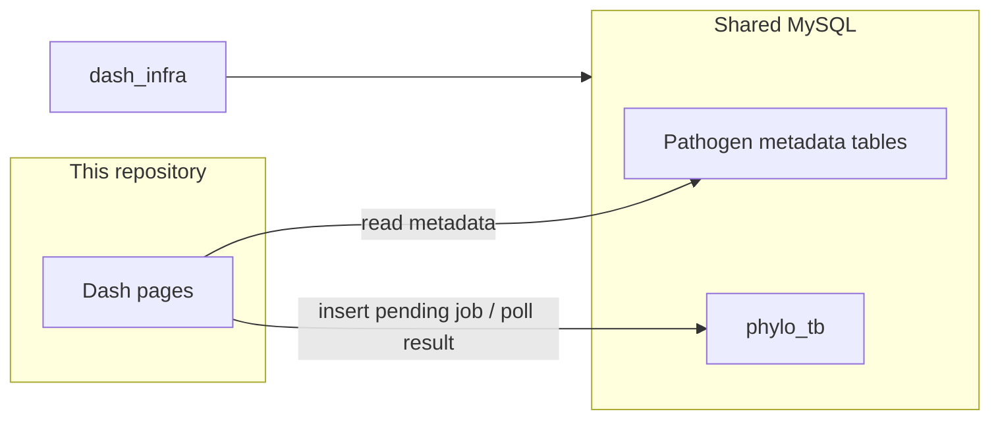
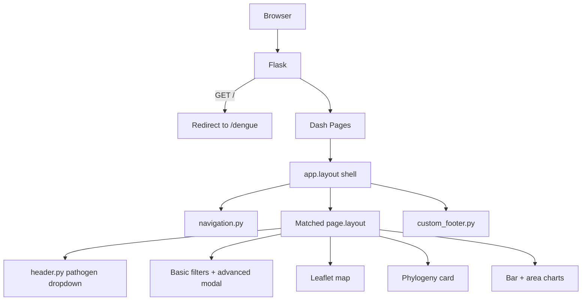

# Architecture

**Purpose**: locate every moving part a new developer will touch: the Dash process, the shared MySQL tables it reads, and where to put new page code.

**Scientific context**: this app filters and draws genomic surveillance metadata. A companion backend (`dash_infra`) loads those tables and completes phylogeny jobs. How it does that can change; treat MySQL as the contract.

**Decision rationale**: the dashboard talks to MySQL only. There is no HTTP API to the backend. Job rows and completed Newick live in `phylo_tb`; epidemiological fields stay on the pathogen metadata tables.

---

## 1. Dash and MySQL

Pages load metadata at import, filter it in memory, and insert a `pending` row into `phylo_tb` when a user requests a tree. The job carries the accession list from that metadata table. The backend writes the finished tree back to the same row; this app then reads it and joins tip colour/hover from the pathogen metadata, not from a separate GenBank table.

---

## 2. Dash process

`src/app.py` creates a Flask server, wraps it in Plotly Dash with `use_pages=True`, and redirects `/` to `/dengue`. The global shell is constant: navbar, `page_container`, footer. Each page module calls `register_page` and supplies a `layout`. Dash imports every page at startup, so **every registered pathogen table is loaded once at boot**.

Switching pathogen is a URL change: the header dropdown writes the route from `src/pathogens.py` into `dcc.Location`, and Dash mounts the matching page.

---

## 3. Where code lives

| Path | Role |
|------|------|
| `src/pathogens.py` | Per-virus spec: table, classification columns, colours, phylo fields, download columns |
| `src/pages/pathogen_dashboard.py` | Shared layout and the main filter callback |
| `src/pages/*_page.py` | Thin wrappers: load that virus’s table, register the route, mount phylogeny |
| `src/pages/scripts/pathogen_script.py` | Import-time cleaning and map/bar aggregations |
| `src/graphs/` | Leaflet map, Plotly bar, Plotly area |
| `src/utils/phylo/` | Pre-check, job workflow, result assembly, tree viewer |
| `src/utils/database/` | SQLAlchemy client (`DashDatabaseClient`) |
| `src/utils/models/` | Mirrored table models (must stay aligned with the live schema) |
| `src/config.py` | Completeness thresholds, tip limits, poll interval |
| `assets/` | CSS/JS served automatically (`assets_folder="../assets"`) |

Adding another arbovirus over an existing metadata table means a registry entry in `src/pathogens.py`, a colour scheme, a thin page module, and a download-config row, not edits to `pathogen_dashboard.py`. `src/tests/pages/test_extension_boundary.py` guards that boundary.

---

## 4. Data-loading model

Each pathogen page, at import:

1. Opens MySQL via `DashDatabaseClient`.
2. Loads the whole metadata table into a pandas DataFrame.
3. Cleans rows (drops missing collection dates, maps ISO country codes, fills `Unassigned`).
4. Writes a TSV under `data/<virus>/` for the CSV download button.
5. Builds the initial unfiltered map, bar, and area figures.

Filter callbacks recompute views from that in-memory frame. They do not query MySQL per Apply. Phylogeny is the exception: job insert and status poll hit `phylo_tb`.

---

## Inputs and outputs

**In:** metadata rows and (for trees) completed `phylo_tb` jobs. **Out:** filtered epidemiological figures and a rendered tree whose tips join back to those metadata rows.

## Interpretation notes

Pathogen pages share one implementation. Virus-specific behaviour is declared in `src/pathogens.py` (dengue currently also applies a 1943 collection-date floor in `dengue_page.py`). If a page looks unique, check the spec before assuming the shared core branched.

## Limitations

Models in `src/utils/models/database_models.py` are a **mirror** of the live schema. If a column is added or renamed in MySQL, this repo must be updated or queries fail.
