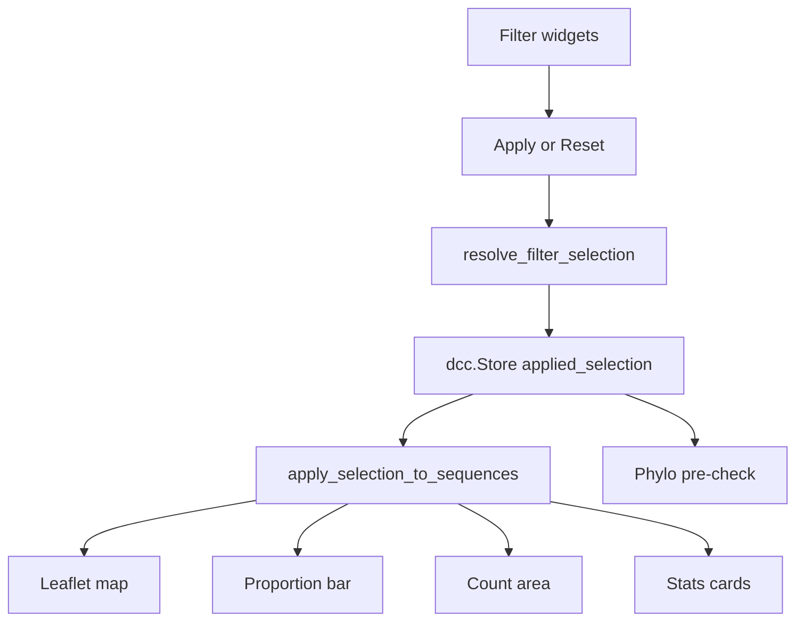

# Pathogen dashboard

**Purpose**: how pathogen pages are assembled, how a filter becomes a selection, and what the map and charts are showing.

**Scientific context**: each page answers the same surveillance questions for one arbovirus: where genomes have been reported, which classification is circulating, and how that mix has changed over the selected dates. A spec may add extras (dengue currently has a serotype-to-genotype cascade and a 1943 date floor).

**Decision rationale**: pathogen routes used to be copy-pasted modules. Shared layout and the main callback now live in `src/pages/pathogen_dashboard.py`; differences are a dictionary in `src/pathogens.py`. Phylogeny is mounted through two insertion points (`filter_extras`, `extra_rows`) so the core does not name trees. Filter logic is **not** folded into the phylo callbacks: Apply writes an applied-selection store, and phylogeny reads that store.

---

## 1. Page structure (top to bottom)

1. Header (title, pathogen dropdown, CSV download) and three stats cards (genomes / countries / hosts).
2. Basic filters: classification, region search, From/To dates, Apply / Reset / Advanced Filters. After the first Apply, the phylogeny toggle appears here.
3. Advanced Filters modal: country vs continent, classification (and subclass when the spec has one), host, date range slider.
4. Geographic Distribution: Leaflet choropleth of genome counts per country, with classification pie icons.
5. Phylogenetic Tree card (hidden until the toggle is on). See [phylogeny.md](phylogeny.md).
6. Circulating classifications: stacked bar of **proportion** over time.
7. Temporal spread: counts over time for the same classification axis.

`/about` is static HTML (project text, data caveats). It is not a pathogen page.

---

## 2. Filter → figures

`resolve_filter_selection` collapses basic vs advanced vs reset into one selection dict (dates, classification lists, countries, continents, hosts). Empty widgets mean “no restriction” (the full vocabulary), not an empty result.

The main callback lives in `register_callbacks` (`pathogen_dashboard.py`). It rebuilds map, bar, area, KPIs, and the download store from the in-memory frame. Continent filtering joins the geojson; it is not a column on the metadata table.

---

## 3. What each chart means

| View | Quantity | Colour |
|------|----------|--------|
| Map | Count of selected genomes per country | Heat for totals; pie icons for classification mix |
| Bar | Proportion of genomes in each time bin | Pathogen colour scheme (`src/utils/color_schemes.py`) |
| Area | Count of genomes in each time bin | Same scheme and legend order |

Legend order comes from `classification_order` on the spec, with `Unassigned` last. Values the palette does not name are rewritten to `Unassigned` at load so they remain drawable.

---

## 4. CSV download

`components/download_btn.py` streams the filtered rows from a `dcc.Store` filled by the main callback, falling back to the TSV written at import (`data/<virus>/Final_global_*.tsv`). Columns are declared per pathogen in `src/pathogens.py` (`download_columns`).

---

## Inputs and outputs

**In:** the pathogen’s metadata DataFrame and the current widget values. **Out:** filtered figures plus an `applied_selection` JSON store that phylogeny and download both consume.

## Interpretation notes

Map counts are sequenced genomes in GenBank after this project’s cleaning rules, not cases. Hover on a country for first/last collection dates in the current filter. The About page disclaimer applies: the feed is not a curated outbreak linelist.

## Limitations

Callbacks are registered globally; component ids carry the pathogen suffix (`denv`, `chikv`, `zikv`) so pages do not collide. The header dropdown ids (`source-dropdown`, `n-url-2`) are shared on purpose, because only one page is mounted at a time. Do not add phylogeny outputs to the main filter callback.
