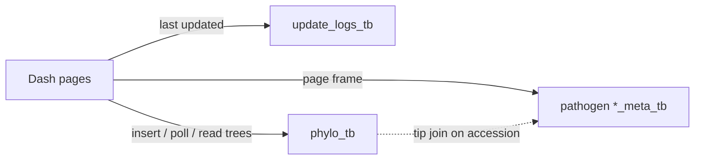
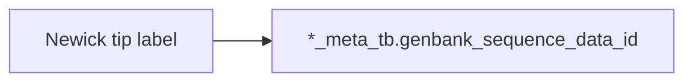

# Data model

**Purpose**: name the MySQL tables this dashboard reads and writes, and the biological meaning of the join keys.

**Scientific context**: surveillance views are built from GenBank metadata already in MySQL, written there by the companion backend. Phylogeny jobs record which accessions were requested and, when finished, the tree text. Epidemiological fields are not duplicated onto the tree row; they are joined by accession so that a later metadata update does not require rewriting Newick.

**Decision rationale**: `phylo_tb` holds Newick (and optional dated NEXUS) because those strings are small enough for a row read and are what the viewer needs. Completeness is **not** taken from GenBank’s `is_complete` flag; the dashboard gates trees on sequence `length` against thresholds in `src/config.py`.

---

## 1. Tables the frontend uses

Summary of the live MySQL schema this app talks to, not a column inventory. Which metadata table a page reads is in `src/pathogens.py` (`meta_entity`). The SQLAlchemy mirror is `src/utils/models/database_models.py`.

Each registered pathogen has one metadata table: one row per genome, with collection date, country, host, length, and that virus's classification columns. Which table, and which classification columns it has, is declared in `src/pathogens.py`. The tables are not interchangeable.

`phylo_tb` is the phylogeny job queue. The dashboard inserts `pending` rows (accession list taken from the pathogen table) and later reads `newick` and `time_tree_nexus` from the same row.

`update_logs_tb` is the "Last updated" stamp.

`ncbi_sequence_data` and `imported_metadata_tb` remain in the schema. Neither is used by the pages or by phylogeny jobs.

---

## 2. Accession join

Tree tip label = NCBI accession. On the metadata tables that value is `genbank_sequence_data_id` (the column name is historical; the dashboard does not join `ncbi_sequence_data`).

A tip with no metadata row is counted as unmatched and is not dropped from the tree.

---

## 3. `phylo_tb` job contract

The dashboard inserts a row with:

- `status="pending"`
- `pathogen`: WHO abbreviation from the spec
- `accession_ids`: the filtered accession list
- `filter_params`: JSON for provenance (dates, completeness, narrowed classification/geography; omitted when the user selected “all”)
- `inference_method`: `fasttree` or `iqtree`

A later update to the same row fills `newick`, `time_tree_nexus`, `accession_set_hash`, `sequence_count`, `warnings`, timestamps, and moves `status` through `processing` → `done` or `failed`. `filter_params` is not the accession source; two filters that resolve to the same accessions (and the same inference settings) can reuse a cached tree unless the user chose “Build a new tree” (`force_rebuild`).

Status values the UI understands: `pending`, `processing`, `done`, `failed`.

---

## 4. Fields drawn on the figures

| Field | Meaning on the dashboard |
|-------|--------------------------|
| `collection_date` | Time window for filters and the temporal charts |
| `country` / ISO code | Map polygons and country filter |
| `host` | Host filter and a stats card |
| `length` | Phylo pre-check (complete-genome vs any-usable-length tiers) |
| `serotype` | Classification column when the spec uses it |
| `genotype` | Classification or subclass column when the spec uses it |
| `major_lineage` / `minor_lineage` | Tree colour-by when the spec declares them |

---

## Inputs and outputs

**In:** metadata and `phylo_tb` rows already in MySQL. **Out:** one pending `phylo_tb` row per tree request, plus in-memory DataFrames that never write back into the metadata tables.

## Interpretation notes

`length` is nucleotides as stored on the metadata row. The complete-genome tier is `WHOLE_GENOME_MIN_LENGTH` (10000 bp); the usable-length floor is `MIN_SEQUENCE_LENGTH` (3000 bp). Those numbers follow a ~10 kb flavivirus genome and are applied to every registered pathogen in this repo.

## Limitations

The mirrored models can drift from the live schema. Completeness is gated on metadata `length`, not on a GenBank completeness flag. Lineage is not a filter widget.
