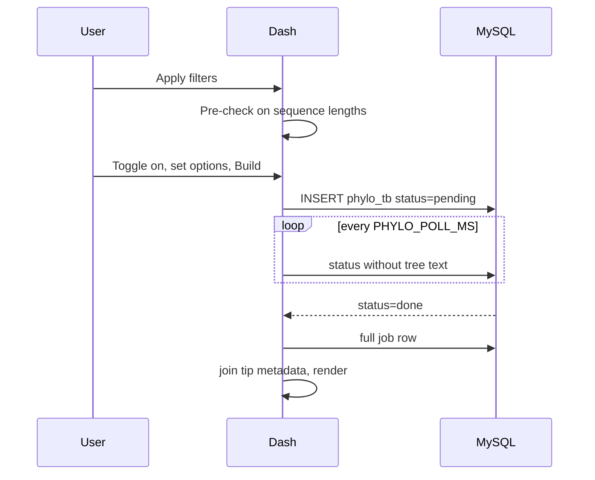
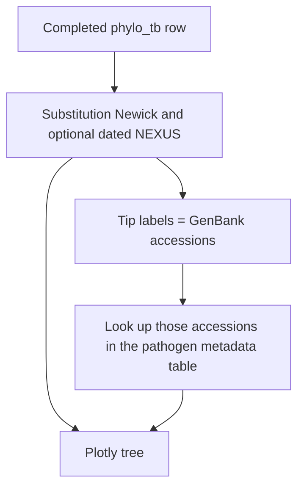

# Phylogeny

**Purpose**: request a tree from the current filter, poll `phylo_tb` until the job is `done`, and draw it with epidemiological colouring.

**Scientific context**: a tree is requested for the **accession set** the user selected, not from the map polygons. Completeness is decided by sequence length (complete-genome tier vs any usable length). The method radio chooses FastTree (fast) or IQ-TREE (branch support). A dated tree may also be present; if it is missing, that is a normal outcome, not a failed job. The backend (`dash_infra`) is what actually builds the tree.

**Decision rationale**: the dashboard writes a `pending` row and polls. It does not run alignment or inference. Tree rendering uses Bio.Phylo as a parser and Plotly for layout (rectangular, circular, radial), the same approach as the vendored `phylotree` viewer under `src/utils/phylo/viewer/`. ETE was ruled out for the web view (Qt, no native Dash surface). Phylocanvas was a POC only and is not on the production path. The substitution Newick and the dated NEXUS are never rewritten or swapped: a NEXUS round-trip through Newick mangles tip labels, and those labels are the accessions the metadata join depends on.

---

## 1. Request flow

Pre-check (in memory) enables the toggle when at least `MIN_TREE_TIPS` sequences meet `MIN_SEQUENCE_LENGTH` and the selection is not above `MAX_SEQUENCES`. The chosen completeness radio is stored on the job; the pre-check uses the looser floor so the toggle is not disabled for “any length” jobs.

Options sent with the job: completeness (`complete_genome` / `any`), inference method (`fasttree` / `iqtree`), and reuse vs `force_rebuild`.

---

## 2. Two trees

A `done` job may contain:

| Column | Branch lengths | What it is for |
|--------|----------------|----------------|
| `newick` | Substitutions per site | Default view; only tree with branch support |
| `time_tree_nexus` | Years | Calendar x-axis; NULL if no dated tree was stored |

The Time control is disabled with a reason when NEXUS is absent. The substitution tree is never relabelled as time-scaled. The dated tree may omit tips that could not be dated; the panel reports tips present in only one of the two trees.

Clock quality (`clock_rate`, R², dated fraction) is shown as measured. A low R² is a property of the selected sequences; the dashboard does not hide a dated tree on that basis.

---

## 3. From job row to figure

The finished row holds tree text. Tips are accession IDs, not isolate names, so colour and hover are looked up afterwards on the pathogen metadata table.

Changing colour-by redraws this figure from the same trees and the same join. It does not request a new job. `result_provider.py` is the only phylogeny file that talks to MySQL; the viewer never sees a database client. Colour-by fields are `phylo_metadata_fields` on the pathogen spec; hover also shows `collection_date`.

---

## 4. Modules

| File | Responsibility |
|------|----------------|
| `utils/phylo/precheck.py` | Length-based eligibility; no Dash, no DB |
| `utils/phylo/job_workflow.py` | Toggle, Start, poll, stage visibility |
| `utils/phylo/result_provider.py` | Job row → result dictionary + join reports |
| `utils/phylo/panel.py` | Layout and figure callbacks |
| `utils/phylo/viewer/` | Newick/NEXUS → Plotly (vendored from `phylotree`) |
| `src/config.py` | Length thresholds, `MAX_SEQUENCES`, `PHYLO_POLL_MS` |

A page mounts the feature with `phylo_toggle_column`, `phylo_rows`, and `register_phylo_job_callbacks`. Each pathogen page does this.

---

## Inputs and outputs

**In:** applied filter selection (accession list + options). **Out:** a Plotly tree whose tips are accessions coloured by a metadata field. Intermediate artifact: one `phylo_tb` row.

## Interpretation notes

These trees are exploratory genomic views for the selected public sequences, not dated outbreak reconstructions by default. IQ-TREE branch support is the number drawn on internal nodes; FastTree jobs have no support values to show. Do not read a pruned appearance on the Time view as a different inference. It is the dated subset.

## Limitations

Jobs remain `pending` until the backend writes a result. `MAX_SEQUENCES` in `src/config.py` is the dashboard’s own gate; a larger selection is rejected before a row is inserted. Changing colour-by does not request a new tree; changing the accession set does.
